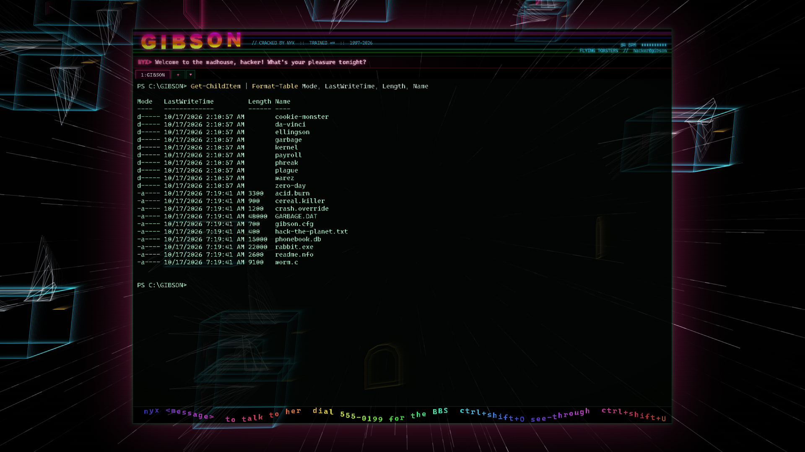
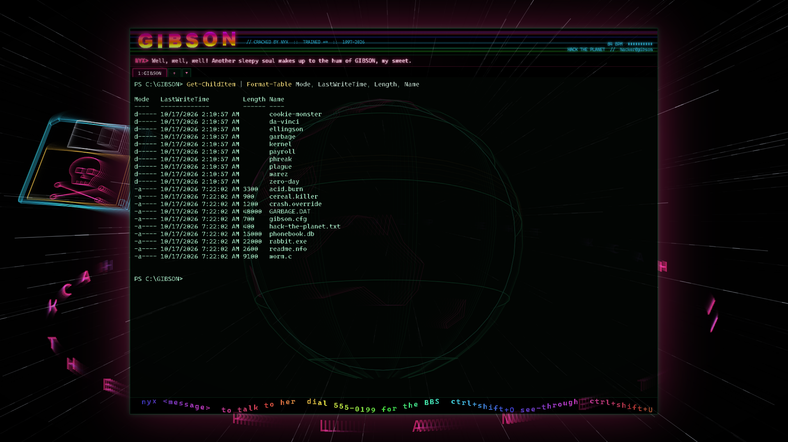
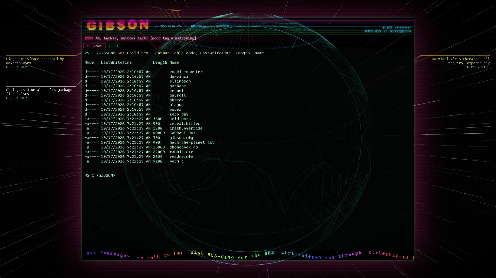
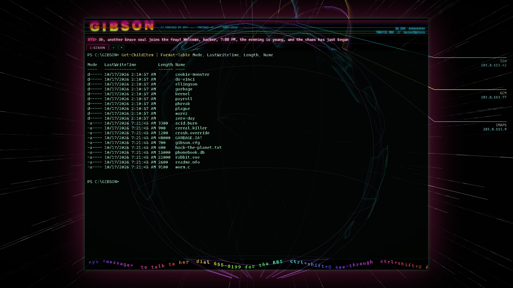

# GIBSON


> *"Hack the planet!"* &nbsp;—&nbsp; a cracktro you can actually work in.

GIBSON is a real terminal dressed up as a 1997 demoscene intro. Your shell sits in the middle of
the screen while wireframe worlds roar past behind it: your own folders as a Hackers-style city,
your git history as a spiral galaxy, your live network connections as satellites, the Gibson
mainframe itself. A synthesized techno/industrial soundtrack speeds up when you work hard and
slumps when you slack off. Or point it at your own music folder and it pumps the visuals to *your*
beat.

Watching it all is **NYX**, the unseen sysop. She greets you when you dial in, needles you about
typos, gasps at `rm -rf`, gets bored when you go idle, comments on the news and your playlist,
and changes the world behind your terminal to suit her mood. Type `nyx <anything>` and she answers.
Plug in a local or hosted LLM and she improvises; without one she has plenty to say anyway.

It is mostly for fun. But some of it is genuinely handy:

- **It's a proper terminal.** PowerShell, cmd, bash, zsh, WSL; tabs; up to four tiled panes per
  tab; copy/paste; clickable links; per-pane see-through so the show goes on behind your work.
- **NETWATCH** draws every live TCP connection your machine has, labelled by service. A new kind
  of connection flares, and NYX will mention it.
- **PROCESS HIVE** is a honeycomb of your running programs: height is memory, heat is CPU, and a
  runaway process glows red, shakes, and gets called out.
- **NEWSWIRE** crawls your RSS feeds across LED tickers, and NYX reacts to fresh headlines.
- **GIT GALAXY** shows the repo you're in as spiral arms, one per branch; new commits ignite.

## Status

**0.8.0, alpha.** Windows is the tested platform (PowerShell via ConPTY). macOS and Linux builds
are produced and smoke-tested by CI, but nobody has lived in them yet.

| | |
|---|---|
| Real shell (node-pty), xterm.js 6 with WebGL, links, Unicode 11 | done |
| Tabs, each with 1 to 4 tiled panes; per-pane opacity; framed or full-window; hideable logo and scroller | done |
| Talk to NYX from any pane: `nyx <message>` | done |
| Twenty-five wireframe worlds, five of them live system data or your RSS feeds | done |
| Shell profiles (PowerShell, PowerShell 7, cmd, WSL, Git Bash, your own); start tabs that reopen in their folders | done |
| Reactive synth soundtrack, 84 to 162 BPM, following your activity | done |
| Jukebox: your own music folder, with controls, visuals pumping on its beat | done |
| Modem dial-in on startup (DTMF, answer tone, handshake screech) | done |
| NYX via Ollama, Anthropic or any OpenAI-compatible API, or canned lines | done (Ollama tested live) |
| Cigarette that burns during builds; Matrix rain flickers | done |
| Installers for Windows, macOS, Linux (unsigned) | done, built by CI |

## Screenshots

Straight from the app, captured headless in a made-up folder (`npm run shots`), so nothing here
is anyone's real machine.

| | |
|---|---|
|  **FILESYSTEM**: the folder you `cd` into, as towers |  **GIBSON CORE**: where `ssh`, `sudo` and `rm -rf` take you |
|  **NETWATCH**: your live TCP connections |  **NEWSWIRE**: your RSS feeds, crawling |
|  **BBS LOBBY**: the board you dial into at boot |  **ICE WALL**: red on an error, cracks open on success |
|  **LIGHT CYCLES**: six riders, one arena |  **BATTLEZONE**: vector tanks and a radar sweep |
|  **Four panes**, each at its own opacity |  **Full window**: no frame, the planet behind your panes |
|  **DEEP SPACE**: fleets trading lasers |  **DATASTREAM**: down the wire |
|  **FLYING TOASTERS**: and toast, some of it burnt |  **HACK THE PLANET**: the Earth, a Jolly Roger floppy, the words going round |
|  **WORLD NEWS**: headlines pop up where they happened |  **TRAFFIC MAP**: your connections arcing out from home |

Also in the box: THE GRID, NEON CITY, ORBIT, RAVE WAREHOUSE, GIT GALAXY, HIGHWAY, DEEP SEA,
PROCESS HIVE, 3D PIPES, 3D MAZE and THE STREET.

## Getting Started

### Quick start

**Easiest:** grab the build for your system from
[Releases](https://github.com/sp00nznet/gibson/releases/latest):

| System | File |
|---|---|
| Windows | `GIBSON-<version>-win-x64-setup.exe` (installer) or `-portable.exe` (no install) |
| macOS | `GIBSON-<version>-mac-arm64.dmg` (Apple silicon) or `-mac-x64.dmg` (Intel) |
| Linux | `GIBSON-<version>-linux-x86_64.AppImage`, or the `.deb` / `.tar.gz` |

The builds are not code-signed. Windows SmartScreen will say "Windows protected your PC": click
**More info**, then **Run anyway**. macOS will say the app "cannot be opened": right-click it,
choose **Open**, then **Open** again (or run `xattr -cr /Applications/GIBSON.app`). On Linux,
`chmod +x` the AppImage first.

**From the source:** download this repository as a zip and unpack it, then:

1. Windows: double-click **`Setup.cmd`**. macOS / Linux: run **`./setup.sh`**.
   It checks for Node.js (and offers to install it), installs the packages, runs the
   self-check, offers NYX's local model if you have Ollama, and makes a launcher.
2. Double-click **`GIBSON.lnk`** (Windows), **`GIBSON.command`** (macOS) or
   **`GIBSON.desktop`** (Linux). Listen to the modem dial in, or press any key to skip it.

If something fails, the script says what to do next and the details are in `setup.log`.

### Step by step

Prerequisites: Node.js 20 or newer (tested on 22 and 24). On Linux, node-pty is compiled during
install, so you also need `make`, `g++` and `python3` (`sudo apt install build-essential
python3`). Optional: [Ollama](https://ollama.com) for NYX's local brain.

1. Install packages (Electron is about 250 MB):
   ```
   npm install
   ```
2. Run the self-check:
   ```
   npm test
   ```
   Expected output:
   ```
   > gibson@0.7.0 test
   > node test/check.mjs

   check: all passed
   ```
3. Optional, give NYX a local model:
   ```
   ollama pull llama3.2:3b
   ```
4. Jack in:
   ```
   npm start
   ```

Trip-ups:

- **Windows:** after installing Node, open a **new** terminal so `npm` is on the PATH.
- **Linux, `npm start` says "The SUID sandbox helper binary was found, but is not configured
  correctly":** Electron's sandbox helper needs root ownership when run from `node_modules`:
  `sudo chown root node_modules/electron/dist/chrome-sandbox && sudo chmod 4755
  node_modules/electron/dist/chrome-sandbox`. The AppImage does not need this.
- **NYX never says anything new:** check `ollama list`, then
  `curl http://127.0.0.1:11434/api/chat -d "{\"model\":\"llama3.2:3b\",\"messages\":[]}"`.
  A model can be listed but missing its files on disk, which returns
  `model "..." not found, try pulling it first` (pull it again).

## Usage

Everything below is also on the **right-click menu**.

**Terminal**

| Key | Does |
|---|---|
| `nyx <message>` | type it (or recall it with Up) in any pane and press Enter: NYX answers; the shell never runs it |
| `Ctrl+Shift+T` / `Ctrl+Shift+X` | new tab / close tab (or the `+` button, and the `x` on each tab or a middle-click) |
| `▾` next to `+` | new tab with another shell: PowerShell, PowerShell 7, cmd, WSL, Git Bash, whatever is installed |
| `Ctrl+Tab` / `Ctrl+Shift+Tab` | next / previous tab (also `Ctrl+PageDown` / `Ctrl+PageUp`) |
| `Ctrl+Shift+1`..`4` | that many panes in this tab. Shrinking keeps the focused pane |
| `Ctrl+Shift+C` / `Ctrl+Shift+V` | copy / paste |

**The look**

| Key | Does |
|---|---|
| `Ctrl+Shift+O` | this pane's opacity, 100% down to 0% (the world shows through) |
| `Ctrl+Shift+F` | framed (centred, glowing border) or full window |
| `Ctrl+Shift+L` | hide or show the GIBSON logo bar |
| `Ctrl+Shift+S` | hide or show the scroller along the bottom |
| `Ctrl+Shift+D` | hide or show the data packets streaming in from the sides |
| `Ctrl+Shift+W` | next world (the right-click menu picks any) |
| `Ctrl+Shift+R` | Matrix rain, now |
| `Ctrl+Shift+N` | NYX on/off |
| `F11` | fullscreen |

**Music**

| Key | Does |
|---|---|
| `Ctrl+Shift+M` | music on/off |
| `Ctrl+Shift+J` | switch between the synth and your music folder (asks for a folder the first time) |
| `Ctrl+Shift+P` | play / pause |
| `Ctrl+Shift+]` / `Ctrl+Shift+[` | next / previous track |
| `Ctrl+Shift+=` / `Ctrl+Shift+-` | volume up / down |
| `Ctrl+Shift+B` | synth tempo: follows your activity, or locked at `music.bpm` |

The **synth** follows your activity averaged over about 12 seconds (typing, and output scrolling
past), so a burst barely moves it and a long session drives it up. The **jukebox** plays a folder
of your own music (mp3, ogg, opus, flac, wav, m4a; subfolders too) at its normal speed, shuffled
or in order, with a clickable player in the bottom-right corner. GIBSON listens for the bass in
whatever is playing, so the frame and the worlds still pump on the beat, and NYX has opinions
about your taste.

**Worlds** change with NYX's mood and with what you do:

| World | When |
|---|---|
| BBS LOBBY | you log in |
| FILESYSTEM | you `cd` (towers are the folder's real entries) |
| GIT GALAXY | any `git` command (your repo's last 150 commits; new ones ignite) |
| ICE WALL | an error (it cracks open when the next command works) |
| GIBSON CORE | `ssh`, `sudo`, `rm -rf` and friends, or NYX feeling intense |
| RAVE WAREHOUSE, HACK THE PLANET | a typing streak (or type `hack the planet`) |
| 3D PIPES | a long build (the screensaver while you wait) |
| 3D MAZE | you go idle (the screensaver kicks in) |
| NETWATCH, TRAFFIC MAP | a kind of connection you haven't made this session |
| PROCESS HIVE | a program hogging the CPU |
| NEWSWIRE, WORLD NEWS | a fresh headline on your feeds |
| LIGHT CYCLES | NYX feeling playful |
| HIGHWAY, NEON CITY, DEEP SPACE, THE GRID | NYX's other moods |
| FLYING TOASTERS | NYX feeling tender, or the menu |
| DATASTREAM, ORBIT, DEEP SEA, THE STREET, BATTLEZONE | the menu or `Ctrl+Shift+W` |

Want one world and no surprises? Right-click > World > **Start in this world** makes the current
one your default, and unticking **NYX picks the world** stops her moving you anywhere.

The TRAFFIC MAP places addresses by which internet registry owns their block (Americas, Europe,
Asia-Pacific, Latin America, Africa), not by geoip: nothing is looked up or sent anywhere, and it
is continent-level at best. Home is guessed from your clock's time zone.

**Settings** live in `config.json`, created on first run. The view choices (opacity, frame, logo,
scroller, packets, cigarette, start world, default shell, start tabs) and the music choices are
remembered for you; everything else you edit by hand
("Open config.json" on the right-click menu), then restart.

| System | Path |
|---|---|
| Windows | `%APPDATA%\gibson\config.json` |
| macOS | `~/Library/Application Support/gibson/config.json` |
| Linux | `~/.config/gibson/config.json` |

```json
{
  "defaultShell": "PowerShell",
  "profiles": [{ "name": "recomp", "shell": "wsl.exe", "args": [], "cwd": "G:\recomp" }],
  "startupTabs": [{ "profile": "PowerShell", "cwd": "F:\projects", "panes": 1 }, { "profile": "WSL", "cwd": "G:\recomp", "panes": 2 }],
  "world": "",
  "nyxWorlds": true,
  "cigarette": true,
  "boot": true,
  "framed": true,
  "logo": true,
  "scroller": true,
  "packets": true,
  "opacity": 0.86,
  "music": { "on": true, "source": "synth", "folder": "", "shuffle": true, "mode": "reactive", "bpm": 128, "volume": 0.55 },
  "news":  { "feeds": ["https://hnrss.org/frontpage", "https://www.theregister.com/security/headlines.atom"], "minutes": 15 },
  "nyx":   { "on": true, "voice": false, "chatter": 0.35 },
  "llm":   { "provider": "ollama", "model": "", "baseUrl": "", "apiKey": "", "shareOutput": false, "minGapSec": 20 }
}
```

- **Shells.** GIBSON finds the installed ones (Windows: PowerShell, PowerShell 7, Command Prompt,
  Git Bash, and each WSL distro by name, Docker Desktop's skipped; elsewhere: `$SHELL` and
  everything in `/etc/shells`, as login shells on macOS). Pick the default with right-click >
  Tabs > Default shell (saved as `defaultShell`), or open a tab in any of them from the `▾`
  button. `profiles` adds your own (`name`, `shell`, `args`, optional starting `cwd`); one with the
  same name as a found shell replaces it. The old `shell` / `shellArgs` settings still work as the
  default when `defaultShell` is blank.
- **Start tabs.** Set your tabs up (shell, folder, panes), then right-click > Tabs > **Open these
  tabs on start**. Next launch they come back in the same shells and folders. Or write
  `startupTabs` by hand. "Forget the start tabs" goes back to one default tab.
- `world`: the world to start in (blank: NYX decides). `nyxWorlds: false` keeps you there.
- `cigarette`: the one that burns while you compile (also on the right-click menu).
- `music.source`: `synth` or `folder` (the jukebox, playing `music.folder`).
- `news.feeds`: any RSS or Atom URLs, fetched every `news.minutes`. `[]` turns the newswire off
  (nothing is fetched).
- `nyx.chatter`: 0 to 1, how often she comments on ordinary commands. Errors, dangerous
  commands, builds and long idles always get a line. `nyx.voice` reads her lines aloud.
- `llm.provider`: `ollama` (default `llama3.2:3b`), `anthropic` (default `claude-opus-5-5`, key
  from `ANTHROPIC_API_KEY`), `openai` (key from `OPENAI_API_KEY`; set `baseUrl` for LM Studio,
  vLLM or any OpenAI-compatible server), or `none` for canned lines only.
- `llm.shareOutput`: also send the last bit of terminal output. Off by default. What NYX sees and
  what leaves your machine is spelled out in [SECURITY.md](SECURITY.md).

**Command line**

```
npm start -- --music "D:\Music\Industrial"     play that folder from the start
npx electron . --shot out.png --world battle --panes 2 --unframed --at 8
```

`--shot` renders offscreen and saves a PNG (works over RDP; no window opens). `--world` is one of
`grid`, `city`, `files`, `battle`, `planet`, `tunnel`, `core`, `bbs`, `rave`, `git`, `ice`,
`highway`, `sea`, `pipes`, `maze`, `cycles`, `battlezone`, `street`, `net`, `hive`, `news`, `toasters`, `newsglobe`, `traffic`, `hack`;
`--tabs 3` opens three tabs and `--chat "are you real?"` types `nyx are you real?` into the first
pane. Shot mode uses a made-up folder, user, connections, programs and headlines, so a capture
never shows your machine. `npm run shots` regenerates everything in `docs/screenshots/`.

How the pieces fit: [docs/architecture.md](docs/architecture.md).

## Building from source

`npm install && npm start` runs the source directly; there is no compile step. To make the
installers for the system you are on:

```
npm run dist
```

Output lands in `dist/` (Windows: setup and portable `.exe`; macOS: `.dmg` and `.zip`; Linux:
AppImage, `.deb`, `.tar.gz`). Releases are built by CI, not by hand: pushing a `v*` tag runs
[`.github/workflows/release.yml`](.github/workflows/release.yml), which builds on all three
systems and publishes a GitHub Release with the notes from [CHANGELOG.md](CHANGELOG.md).

New worlds are one file each in `renderer/worlds/` (see `Worlds.define` in
[docs/architecture.md](docs/architecture.md)). The icon is drawn by `scripts/icon.js`
(`npm run icon`). Contributions are welcome; see [CONTRIBUTING.md](CONTRIBUTING.md).

## License

MIT, see [LICENSE](LICENSE). The soundtrack, the visuals and the icon are generated in code; the
repository contains no third-party assets ([PROVENANCE.md](PROVENANCE.md)). Installers bundle
Electron, xterm.js and node-pty under their own MIT licences. Your music stays yours: GIBSON
plays it from your disk and never copies or uploads it.
