# GIBSON

A cracktro you can work in. A real terminal sits in the middle of the screen, framed by
wireframe worlds: your own filesystem as a Hackers-style city, your git history as a galaxy, the
Gibson mainframe, your live network connections, your running programs, a news ticker, a 90s
BBS, light cycles, Battlezone, the 3D Pipes and Maze screensavers, a rave, black ICE and more. A synthesized techno/industrial soundtrack speeds up when you work
hard and settles down when you stop. Watching it all is **NYX**, the unseen sysop: she greets
you, needles you about typos, roots for you anyway, and changes the world behind the terminal to
suit her mood. A local or hosted LLM can write her lines; without one she has her own.

## Status

**0.5.0, alpha.** Windows is the tested platform (PowerShell via ConPTY). macOS and Linux
builds are produced and smoke-tested by CI, but nobody has used them day to day yet.

| | |
|---|---|
| Real shell (node-pty), xterm.js 6 with WebGL, links, Unicode 11 | done |
| Tabs, each with 1 to 4 tiled panes; per-pane opacity; framed or full-window view | done |
| Talk to NYX from any pane: `nyx <message>` | done |
| Twenty-one wireframe worlds, three of them from live system data and one from RSS | done |
| Reactive soundtrack: kick, bass, acid line, distorted guitar chugs, pad; 84 to 162 BPM | done |
| Modem dial-in on startup (DTMF, answer tone, handshake) | done |
| NYX: canned personality, moods pick worlds, optional voice | done |
| NYX via Ollama, Anthropic or any OpenAI-compatible API | done (Ollama tested live) |
| Cigarette that burns while a build runs; Matrix rain flickers | done |
| Installers for Windows, macOS, Linux (unsigned) | done, built by CI |

## Screenshots

From the app itself, captured headless (`npm run shots`) in a made-up demo folder.

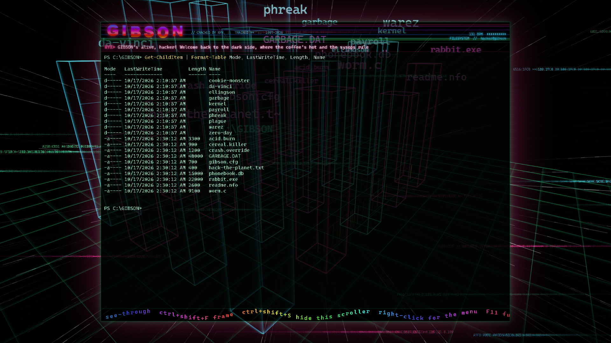
*FILESYSTEM: the folder you `cd` into, as towers. Directories are blue, files pink, height is size.*

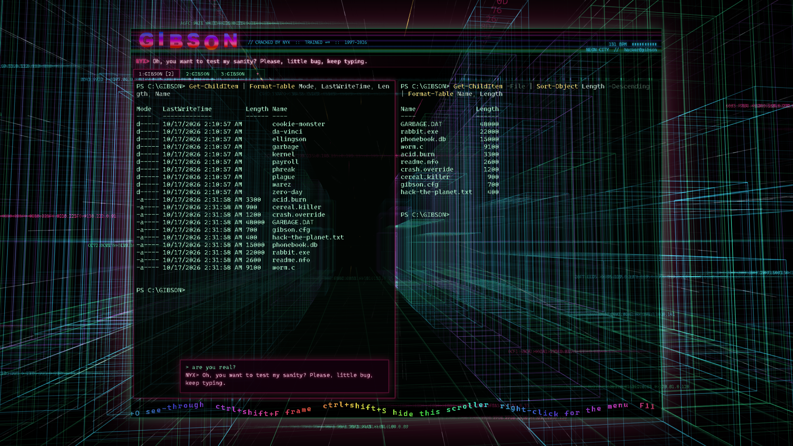
*Tabs (`Ctrl+Shift+T`), panes, and `nyx are you real?`: her answer floats over the pane.*

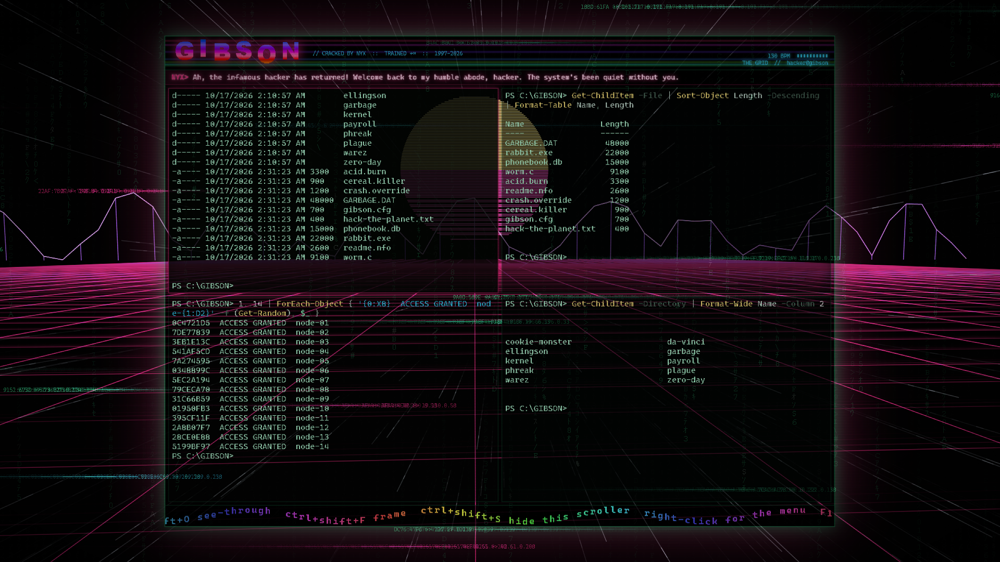
*Four panes (`Ctrl+Shift+4`), each at its own opacity (`Ctrl+Shift+O`).*

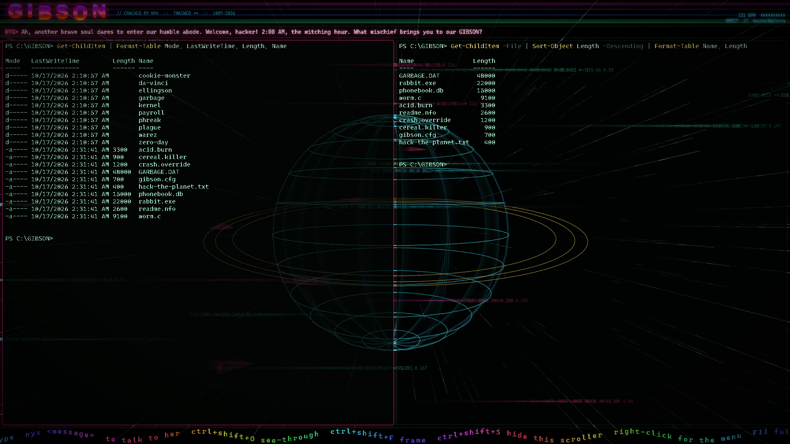
*Full window (`Ctrl+Shift+F`): no frame, the scene runs behind the panes.*

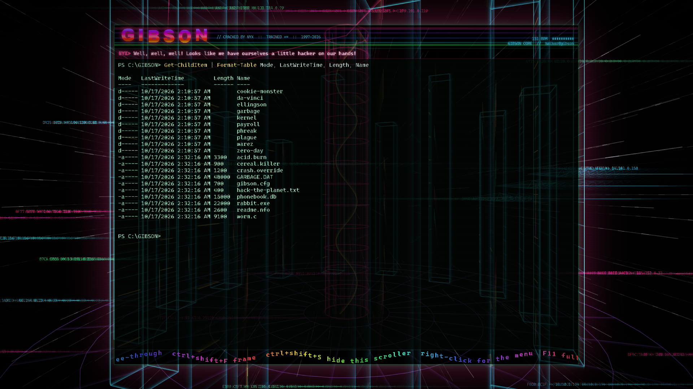
*GIBSON CORE: where NYX takes you for `ssh`, `sudo` and anything dangerous.*

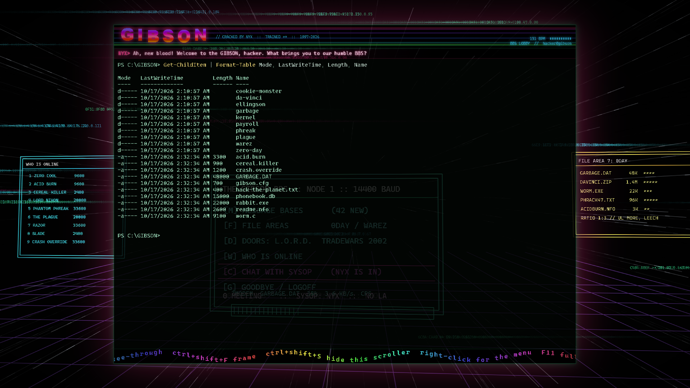
*BBS LOBBY: the board you dial into at boot.*

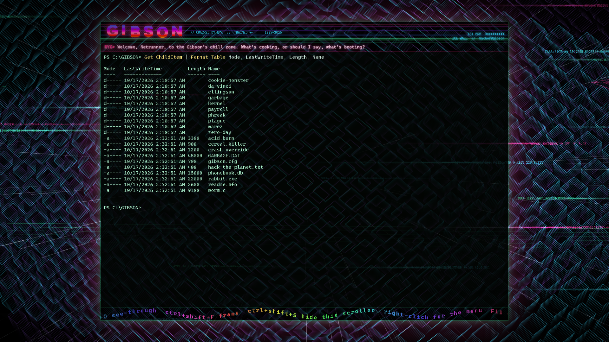
*ICE WALL: flares red on an error, cracks open when the next command works.*

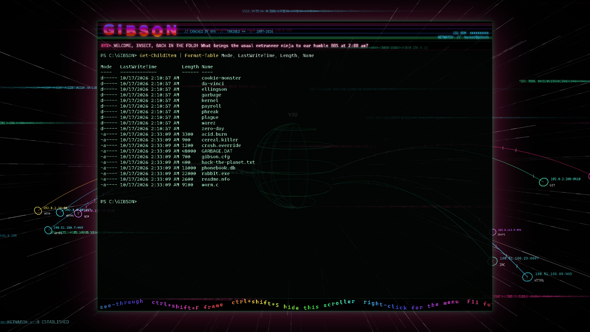
*NETWATCH: your machine's live TCP connections (made-up addresses in this capture).*

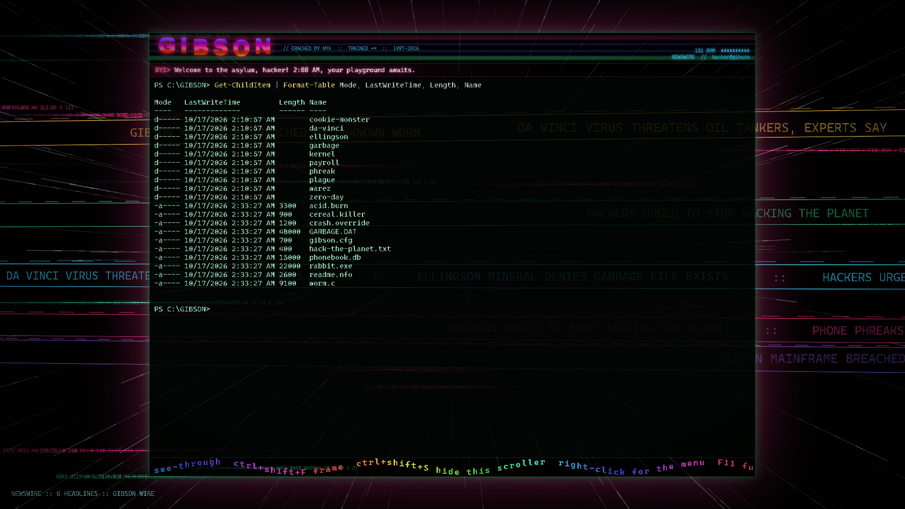
*NEWSWIRE: your RSS feeds on ticker bands. NYX comments on fresh headlines.*

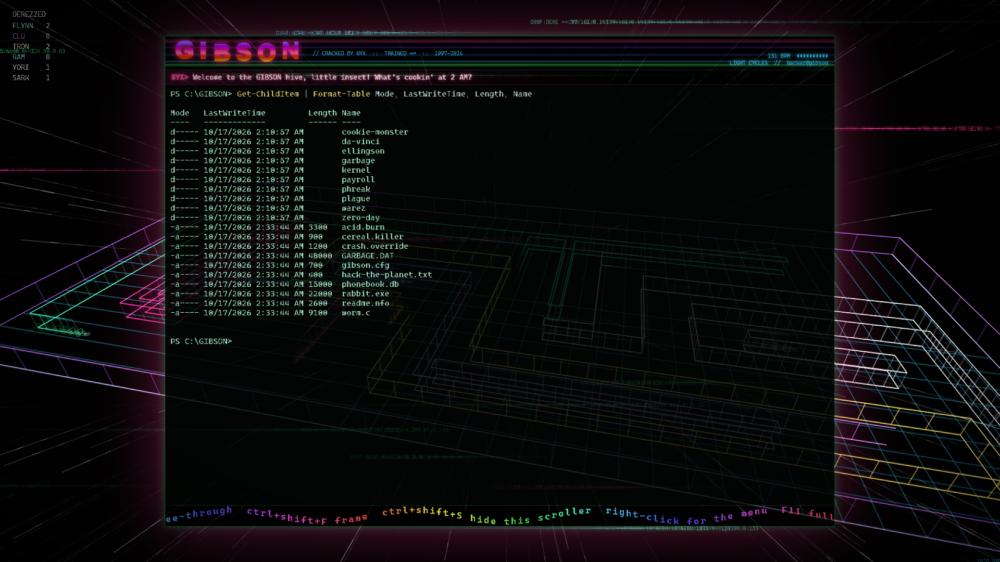
*LIGHT CYCLES: six riders, one arena, a scoreboard of who got derezzed.*

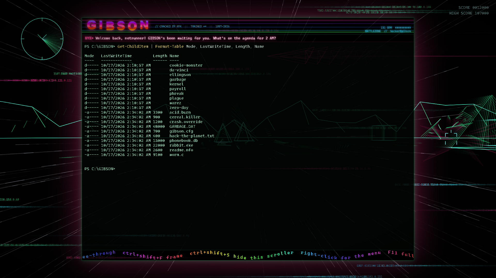
*BATTLEZONE: green vectors, a volcano and a radar sweep in the corner.*

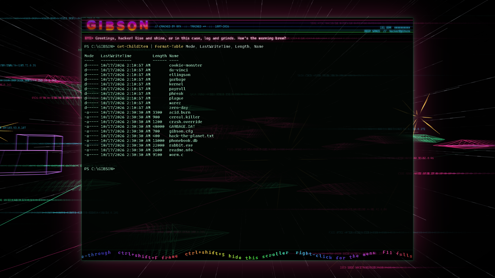
*DEEP SPACE: two fleets trading lasers, a capital ship sliding past.*

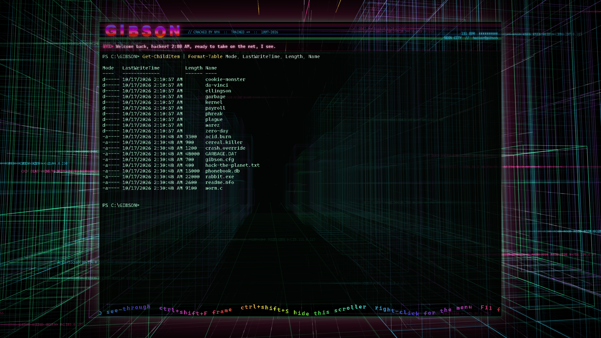
*NEON CITY: flying down the avenue, traffic overhead.*

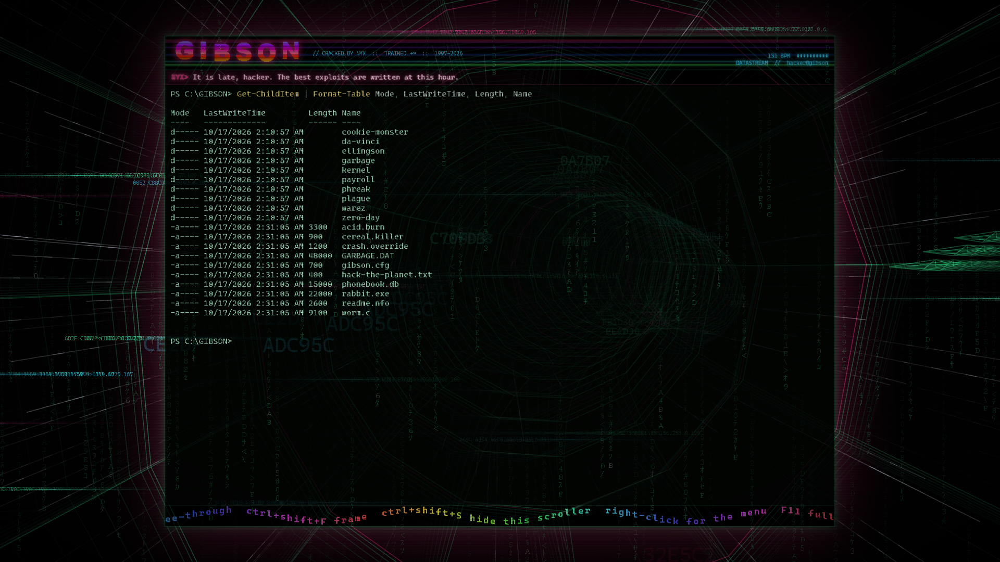
*DATASTREAM: where NYX takes you during a long build.*

## Getting Started

### Quick start

**Easiest:** download the build for your system from
[Releases](https://github.com/sp00nznet/gibson/releases/latest):

| System | File |
|---|---|
| Windows | `GIBSON-<version>-win-x64-setup.exe` (installer) or `-portable.exe` (no install) |
| macOS | `GIBSON-<version>-mac-arm64.dmg` (Apple silicon) or `-mac-x64.dmg` (Intel) |
| Linux | `GIBSON-<version>-linux-x86_64.AppImage`, or the `.deb` / `.tar.gz` |

The builds are not code-signed. Windows SmartScreen will say "Windows protected your PC": click
**More info**, then **Run anyway**. macOS will say the app "cannot be opened": right-click it,
choose **Open**, then **Open** again (or run `xattr -cr /Applications/GIBSON.app`). On Linux,
`chmod +x` the AppImage first.

**From the source:** download this repository as a zip and unpack it, then:

1. Windows: double-click **`Setup.cmd`**. macOS / Linux: run **`./setup.sh`**.
   It checks for Node.js (and offers to install it), installs the packages, runs the
   self-check, offers NYX's local model if you have Ollama, and makes a launcher.
2. Double-click **`GIBSON.lnk`** (Windows), **`GIBSON.command`** (macOS) or
   **`GIBSON.desktop`** (Linux). Press any key to skip the dial-in.

If something fails, the script says what to do next and the details are in `setup.log`.

### Step by step

Prerequisites: Node.js 20 or newer (tested on 22 and 24). On Linux, node-pty is compiled during
install, so you also need `make`, `g++` and `python3` (`sudo apt install build-essential
python3`). Optional: [Ollama](https://ollama.com) for NYX's local brain.

1. Install packages (Electron is about 250 MB):
   ```
   npm install
   ```
2. Run the self-check:
   ```
   npm test
   ```
   Expected output:
   ```
   > gibson@0.5.0 test
   > node test/check.mjs

   check: all passed
   ```
3. Optional, give NYX a local model:
   ```
   ollama pull llama3.2:3b
   ```
4. Jack in:
   ```
   npm start
   ```

Trip-ups:

- **Windows:** after installing Node, open a **new** terminal so `npm` is on the PATH.
- **Linux, `npm start` says "The SUID sandbox helper binary was found, but is not configured
  correctly":** Electron's sandbox helper needs root ownership when run from `node_modules`:
  `sudo chown root node_modules/electron/dist/chrome-sandbox && sudo chmod 4755
  node_modules/electron/dist/chrome-sandbox`. The AppImage does not need this.
- **NYX never says anything new:** check `ollama list`, then
  `curl http://127.0.0.1:11434/api/chat -d "{\"model\":\"llama3.2:3b\",\"messages\":[]}"`.
  A model can be listed but missing its files on disk, which returns
  `model "..." not found, try pulling it first` (pull it again).

## Usage

| Key | Does |
|---|---|
| `nyx <message>` | type it (or recall it with Up) in any pane and press Enter: NYX answers you; the shell never runs it |
| `Ctrl+Shift+T` / `Ctrl+Shift+X` | new tab / close tab (or the `+` button; middle-click a tab to close it) |
| `Ctrl+Tab` / `Ctrl+Shift+Tab` | next / previous tab (also `Ctrl+PageDown` / `Ctrl+PageUp`) |
| `Ctrl+Shift+1`..`4` | that many panes in this tab, each its own shell. Shrinking keeps the focused pane |
| `Ctrl+Shift+O` | this pane's opacity, 100% down to 0% (the world shows through) |
| `Ctrl+Shift+F` | framed (centred, glowing border) or full window |
| `Ctrl+Shift+S` | hide or show the scroller along the bottom |
| `Ctrl+Shift+W` | next world |
| `Ctrl+Shift+M` | music on/off |
| `Ctrl+Shift+B` | tempo: follows your activity, or locked at `music.bpm` |
| `Ctrl+Shift+N` | NYX on/off |
| `Ctrl+Shift+R` | Matrix rain now |
| `Ctrl+Shift+C` / `Ctrl+Shift+V` | copy / paste |
| `F11` | fullscreen |
| right-click | a menu with all of the above, a world picker, and `config.json` |

Each tab has its own panes; the tab bar appears once there is more than one tab, and each tab is
named after its folder. `nyx` with a message talks to her directly: with a model configured she
remembers the last few exchanges; without one she still answers, briefly. The conversation shows
over the bottom of the pane for 30 seconds.

Worlds change with NYX's mood and with what you do:

| World | When |
|---|---|
| BBS LOBBY | you log in |
| FILESYSTEM | you `cd` (towers are the folder's real entries) |
| GIT GALAXY | any `git` command (your repo's last 150 commits as spiral arms; new commits ignite) |
| ICE WALL | an error (it cracks open when the next command works) |
| GIBSON CORE | `ssh`, `sudo`, `rm -rf` and friends, or NYX feeling intense |
| RAVE WAREHOUSE | a typing streak (speakers and the crowd move on the kick) |
| 3D PIPES | a long build (the screensaver while you wait) |
| 3D MAZE | you go idle (the screensaver kicks in) |
| NETWATCH | a kind of connection you haven't made this session (live: `netstat` / `ss`) |
| PROCESS HIVE | a program hogging the CPU (live: one cell per program, height is memory, heat is CPU) |
| NEWSWIRE | a fresh headline on your RSS feeds |
| LIGHT CYCLES | NYX feeling playful |
| HIGHWAY, DEEP SEA, NEON CITY, DEEP SPACE, THE GRID | NYX's other moods |
| DATASTREAM, ORBIT, THE STREET, BATTLEZONE | the menu or `Ctrl+Shift+W` |

`Ctrl+Shift+W` steps through them and the right-click menu picks one.

Opacity, the framed/full-window choice and the scroller are remembered. The tempo follows your activity
averaged over about 12 seconds (typing, and output scrolling past), so a burst barely moves it
and a long session drives it up.

Settings live in `config.json`, created on first run (restart to apply):

| System | Path |
|---|---|
| Windows | `%APPDATA%\gibson\config.json` |
| macOS | `~/Library/Application Support/gibson/config.json` |
| Linux | `~/.config/gibson/config.json` |

```json
{
  "shell": "powershell.exe",
  "boot": true,
  "framed": true,
  "scroller": true,
  "news":  { "feeds": ["https://hnrss.org/frontpage", "https://www.theregister.com/security/headlines.atom"], "minutes": 15 },
  "opacity": 0.86,
  "music": { "on": true, "mode": "reactive", "bpm": 128, "volume": 0.55 },
  "nyx":   { "on": true, "voice": false, "chatter": 0.35 },
  "llm":   { "provider": "ollama", "model": "", "baseUrl": "", "apiKey": "", "shareOutput": false, "minGapSec": 20 }
}
```

- `shell`: `pwsh.exe`, `cmd.exe`, `wsl.exe`, `bash`, `zsh`... `shellArgs` passes arguments.
  The default is PowerShell on Windows and `$SHELL` elsewhere.
- `nyx.chatter`: 0 to 1, how often she comments on ordinary commands. Errors, dangerous
  commands, builds and long idles always get a line.
- `nyx.voice`: read her lines aloud with the system's speech voice.
- `llm.provider`: `ollama` (default `llama3.2:3b`), `anthropic` (default `claude-opus-5-5`, key
  from `ANTHROPIC_API_KEY`), `openai` (key from `OPENAI_API_KEY`; set `baseUrl` for LM Studio,
  vLLM or any OpenAI-compatible server), or `none` for canned lines only.
- `llm.shareOutput`: also send the last bit of terminal output. Off by default; see
  [SECURITY.md](SECURITY.md).
- `news.feeds`: any RSS or Atom URLs, fetched every `news.minutes`. `[]` turns the newswire off
  (nothing is fetched).

Headless screenshot (no window opens, so it works over RDP):

```
npx electron . --shot out.png --world battle --panes 2 --unframed --at 8
```

`--world` is one of `grid`, `city`, `files`, `battle`, `planet`, `tunnel`, `core`, `bbs`, `rave`,
`git`, `ice`, `highway`, `sea`, `pipes`, `maze`, `cycles`, `battlezone`, `street`, `net`,
`hive`, `news`; `--tabs 3` opens three
tabs and `--chat "are you real?"` types `nyx are you real?` into the first pane. Shot mode runs the
shells in a made-up folder as `hacker@gibson`, so a capture never shows your machine.
`npm run shots` regenerates everything in `docs/screenshots/`.

How the pieces fit: [docs/architecture.md](docs/architecture.md).

## Building from source

`npm install && npm start` runs the source directly; there is no compile step. To make the
installers for the system you are on:

```
npm run dist
```

Output lands in `dist/` (Windows: setup and portable `.exe`; macOS: `.dmg` and `.zip`; Linux:
AppImage, `.deb`, `.tar.gz`). Releases are built by CI, not by hand: pushing a `v*` tag runs
[`.github/workflows/release.yml`](.github/workflows/release.yml), which builds on all three
systems and publishes a GitHub Release with the notes from [CHANGELOG.md](CHANGELOG.md).

The icon is drawn by `scripts/icon.js` (`npm run icon` rewrites `build/icon.png` and
`build/icon.ico`).

Contributions are welcome; see [CONTRIBUTING.md](CONTRIBUTING.md).

## License

MIT, see [LICENSE](LICENSE). The soundtrack, the visuals and the icon are generated in code; the
repository contains no third-party assets ([PROVENANCE.md](PROVENANCE.md)). Installers bundle
Electron, xterm.js and node-pty under their own MIT licences.
